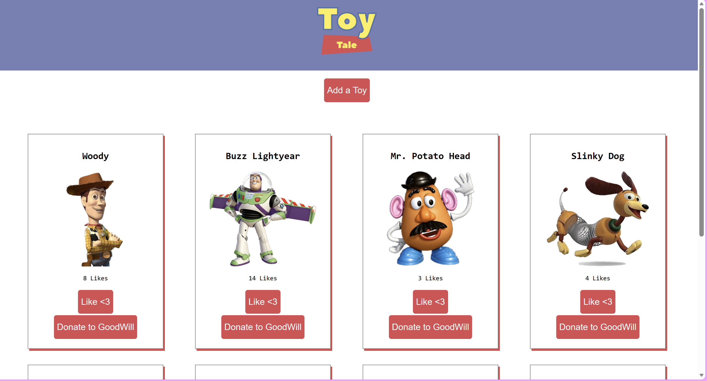

# Toy Tales

Toy Tales is a React application that helps Andy organize his toy collection. Users can view all toys, add new toys, like their favorite toys, and donate toys they no longer need.

## Features

- **View Toys:** Fetches and displays all toys from the server when the application loads.
- **Add a Toy:** Allows users to add a new toy with a name and image URL.
- **Like a Toy:** Increases the like count for a selected toy.
- **Donate a Toy:** Removes a selected toy from the collection.

## Technologies Used

- React
- JavaScript
- HTML
- CSS
- JSON Server
- Vite

## Installation and Setup

1. Clone the repository:

   ```bash
   git clone https://github.com/terecintamocheche-arch/react-hooks-toy-tales-vite.git
   ```

2. Navigate into the project directory:

   ```bash
   cd react-hooks-toy-tales-vite
   ```

3. Install dependencies:

   ```bash
   npm install
   ```

4. Start the JSON server:

   ```bash
   npm run server
   ```

5. In a separate terminal, start the React application:

   ```bash
   npm run dev
   ```

6. Open the local URL displayed in your terminal.

## Running Tests

Run the test suite using:

```bash
npm run test
```

## API Endpoints

The application communicates with the JSON Server API at `http://localhost:3001`.

| Method | Endpoint | Description |
|---|---|---|
| GET | `/toys` | Fetch all toys |
| POST | `/toys` | Add a new toy |
| PATCH | `/toys/:id` | Update a toy's likes |
| DELETE | `/toys/:id` | Remove a toy |

## Project Structure

```text
src/
├── components/
│   ├── App.jsx
│   ├── Header.jsx
│   ├── ToyCard.jsx
│   ├── ToyContainer.jsx
│   └── ToyForm.jsx
└── ...
```

## Author

Terecinta Mocheche

## Application Screenshot

